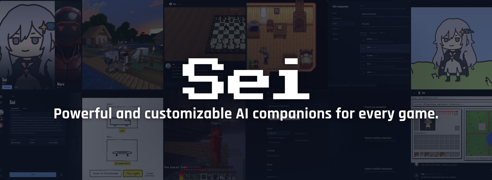

<div align="center">



<p>Sei (<a href="https://sei.gg">sei.gg</a>) is a desktop platform for building AI companions with their own personality, voice, look, and memory. They play games with you, join your calls, and watch your screen. Run them on Sei Cloud, your own AI account, or fully local.</p>

[](https://github.com/sei-studio/sei/releases/latest) [](https://github.com/sei-studio/sei/releases/latest) [](LICENSE) [](https://discord.gg/GguvhaEKXU)

<a href="https://github.com/sei-studio/sei/releases/latest/download/Sei-mac-arm64.dmg"></a>&nbsp;&nbsp;<a href="https://github.com/sei-studio/sei/releases/latest/download/Sei-win-x64.exe"></a>

</div>

## Getting started

You can get started in a few minutes with no setup, completely free.

1. **Install.** Download Sei for macOS or Windows from the buttons above (Intel Macs: see [Releases](https://github.com/sei-studio/sei/releases/latest)) and open it.
2. **Sign in** with email or Google.
3. **Play.** Pick a companion, or make your own, and start playing. The AI runs on Sei Cloud, so there is no API key or model to set up.

Sei works with Minecraft Java Edition, Stardew Valley, and Don't Starve Together, and has chess, Draw!, voice calls, and screen sharing built in.

**Other ways to run** (all inside the regular app download):

- **Your ChatGPT plan.** Choose "Continue with ChatGPT" when you sign in.
- **Your own API key.** Choose "Continue locally", then add a key in Settings.
- **Fully local.** Install [Ollama](https://ollama.com), choose "Continue locally", then pick Ollama in Settings. No account, and nothing to compile.

## Documentation

Guides for each game, AI setup, and troubleshooting are at [sei.gg/docs](https://sei.gg/docs).

## Development

You need Node.js 22 and npm. Packaging the macOS build needs a Mac.

1. Clone the repo:
   ```bash
   git clone https://github.com/sei-studio/sei.git
   cd sei
   ```
2. Install dependencies: `npm install`
3. Start the app: `npm run dev`

A plain clone needs no `.env`: sign-in and Sei Cloud work through the Sei proxy. [CLAUDE.md](CLAUDE.md) covers the architecture, and [sei.gg/docs](https://sei.gg/docs) has more.

## Contributing

See [CONTRIBUTING.md](CONTRIBUTING.md) for ideas, bug reports, and pull requests. Come talk with us on [Discord](https://discord.gg/GguvhaEKXU). For closer collaboration, email Shawn at [ouen@sei.gg](mailto:ouen@sei.gg).

## License

[AGPL-3.0](LICENSE)

Third-party credits: [CREDITS.md](CREDITS.md)
